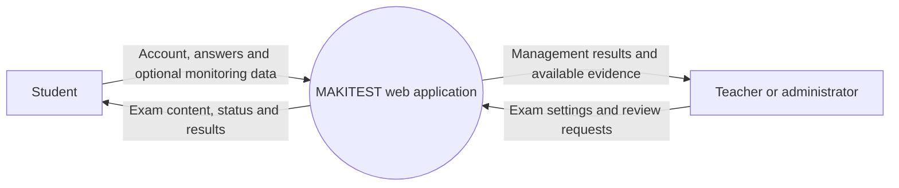
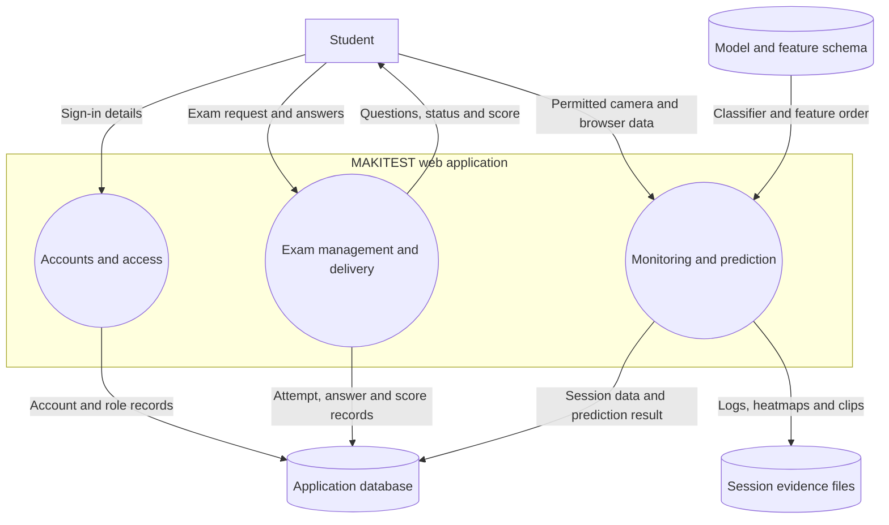
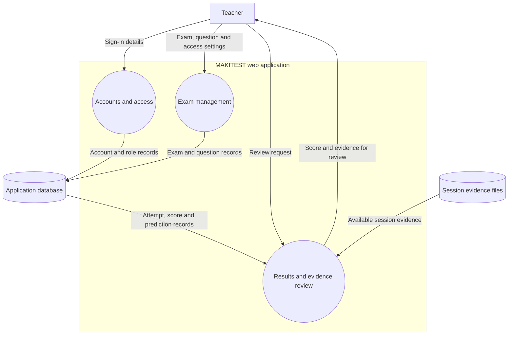
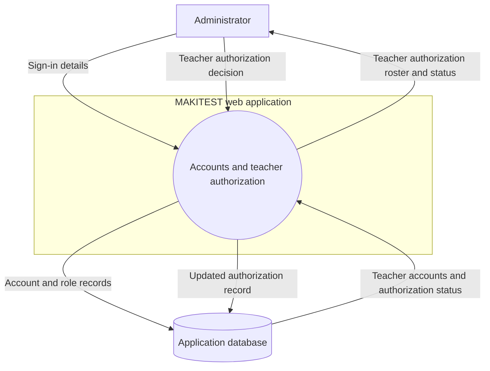
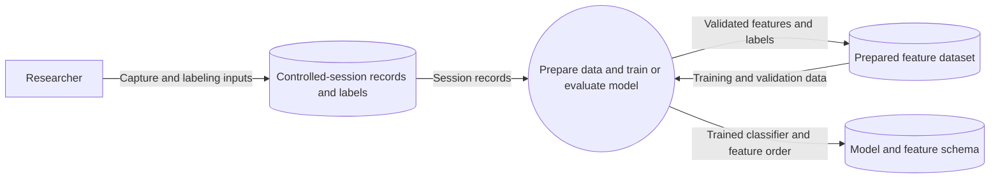
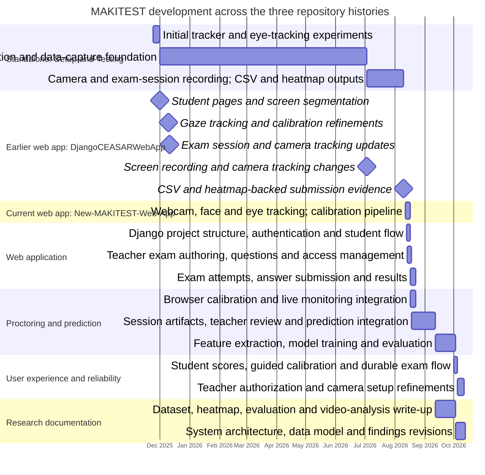
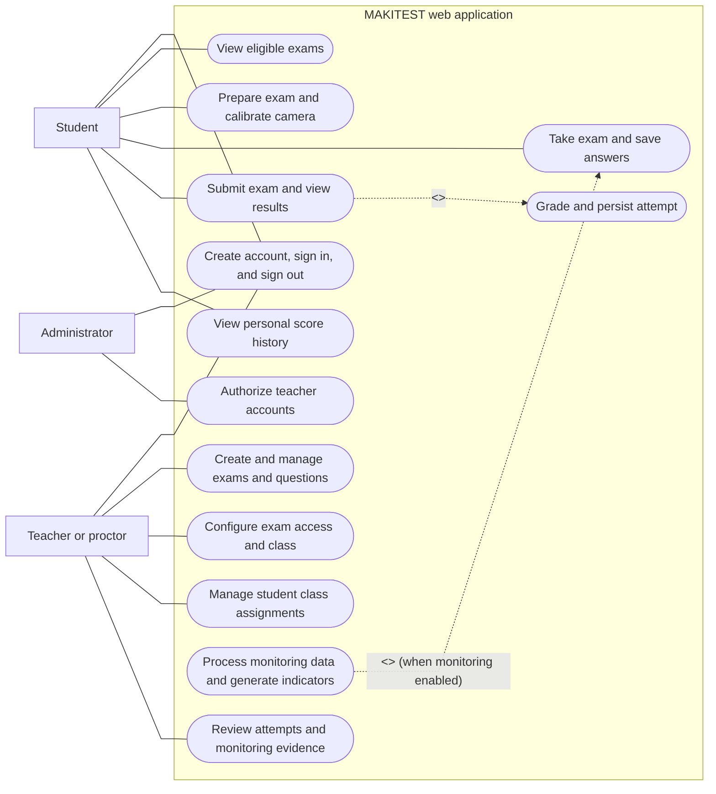

# Appendix A
## High-Level Data Flow Diagram of the MAKITEST System

### A.1 Purpose and scope

This appendix summarizes how MAKITEST data moves through account access, exam delivery, optional session monitoring, and staff review. It presents the integrated Django web application as a small set of functional groups; the separate offline research workflow is shown only where it supplies model files for prediction.

The diagrams show logical functions and data stores, not individual views, database fields, or deployment infrastructure. Monitoring indicators and prediction results support human review and do not, by themselves, establish misconduct.

### A.2 System context (Level 0 DFD)

The context view treats the web application as one process and limits the diagram to its main users and exchanges.

<!-- mermaid-checked: no \n, no em-dash/en-dash, no {} in labels, subgraphs are id["label"], arrows are -->|"label"|, all subgraphs closed by end, ids unique -->

### A.3 Student, teacher, and administrator DFDs (Level 1)

The live application flows are separated by actor to make each role's exchanges easier to follow. Monitoring is optional for an exam; answer scoring remains part of exam delivery. The model and feature schema are inputs to prediction, but are developed separately in the researcher DFD.

#### A.3.1 Student DFD

<!-- mermaid-checked: no \n, no em-dash/en-dash, no {} in labels, subgraphs are id["label"], arrows are -->|"label"|, all subgraphs closed by end, ids unique -->

#### A.3.2 Teacher DFD

<!-- mermaid-checked: no \n, no em-dash/en-dash, no {} in labels, subgraphs are id["label"], arrows are -->|"label"|, all subgraphs closed by end, ids unique -->

#### A.3.3 Administrator DFD

<!-- mermaid-checked: no \n, no em-dash/en-dash, no {} in labels, subgraphs are id["label"], arrows are -->|"label"|, all subgraphs closed by end, ids unique -->

### A.4 Researcher and model-development DFD

This separate offline flow starts with controlled-session records and labels. Its output is the model and feature schema consumed by the live application's prediction function; training does not occur during an exam.

<!-- mermaid-checked: no \n, no em-dash/en-dash, no {} in labels, subgraphs are id["label"], arrows are -->|"label"|, all subgraphs closed by end, ids unique -->

### A.5 Functional groups

| Group | Included features |
|---|---|
| **Accounts and access** | Sign-in, role-based routing, and teacher authorization. |
| **Exam management and delivery** | Exam and question setup, access settings, eligibility checks, answer saving, submission, and score calculation. |
| **Optional session monitoring** | Browser-based calibration, camera and supported browser-event processing, and creation of session indicators and evidence. |
| **Results and evidence review** | Attempt and prediction status retrieval, evidence access when available, and teacher review. |
| **Offline model development** | Preparation of research data and training/evaluation of the model used by web-session prediction. This is not performed during an exam. |

### A.6 Data stores

| Store | Contents |
|---|---|
| **Application database** | Accounts, roles, exams, questions, attempts, answers, scores, and prediction status. The current project configuration uses SQLite. |
| **Session evidence files** | Session logs, heatmaps, clips, and prediction output when produced. The database stores references to registered files. |
| **Model and feature schema** | The trained classifier and expected feature order used for prediction. |

### A.7 Data-flow summary and boundaries

1. The application authenticates users and provides features according to their roles.
2. Students access eligible exams, save answers, and submit attempts; the application calculates and stores scores.
3. If monitoring is enabled and browser permissions allow it, the session produces indicators and evidence. Prediction may be unavailable if its inputs or model are unavailable; this does not imply a positive classification.
4. Teachers review scores, prediction status, and available evidence. Any decision remains a human judgment.
5. The offline research workflow prepares data and produces the model files used by the application; it is separate from live exam processing.

The monitoring scope shown here is limited to browser-permitted camera frames and supported browser-reported events, with gaze, head-pose, heatmap, and rule-based indicators. Facial recognition, liveness detection, object or hand detection, audio analysis, and operating-system-wide keyboard capture are not represented as implemented features. Deployment infrastructure and data-retention policy are outside this logical DFD.

# Appendix B
## Development Timeline of the MAKITEST System

### B.1 Basis of the timeline

This timeline synthesizes the dated Git commit histories of the current repository and the two related repositories, [Setup-and-Testing](https://github.com/pfftbuh/Setup-and-Testing) and [DjangoCEASARWebApp](https://github.com/pfftbuh/DjangoCEASARWebApp), together with the current project structure. It groups related commits into system-development workstreams rather than listing every commit individually. The dates indicate when a notable implementation or documentation change is recorded in a repository; they should not be interpreted as the exact start and finish dates of all work.

Across the three histories, the chart covers November 24, 2025, through October 13, 2026. To avoid displaying empty intervals, a workstream with no subsequent notable update is extended to the next relevant milestone or the end of its observed history. These extensions are a presentation convention and do not imply continuous development on every intervening day. Parallel workstreams may overlap.

### B.2 Gantt chart

### B.3 Kanban-style retrospective and development timeline

This retrospective groups recorded work into Kanban-style workstreams: foundational tracking and data capture, web-app delivery, monitoring and model integration, evaluation, and research documentation. The repository histories provide dated evidence of completed changes, but do not contain a maintained board with explicit priority labels or a complete list of in-progress tickets. Accordingly, the priority column below is inferred from dependency and commit sequence, not presented as a priority recorded by the developers: **P1 = high / prerequisite**, **P2 = medium / dependent feature or validation**, and **P3 = supporting work**. “Backlog / next work” identifies either a follow-on item visible in later commits or a limitation/future validation need stated in the manuscript; it is not a claim that a formal issue was filed.

| Recorded period and repository | Item developed (status at evidence cutoff) | Development category | Iterations recorded in history | Backlog / next work indicated by the sequence | Inferred priority |
|---|---|---|---|---|---|
| Nov. 2025–Aug. 2026 — [Setup-and-Testing](https://github.com/pfftbuh/Setup-and-Testing) | Standalone tracker, calibration, gaze capture, session logs, CSV and heatmap outputs (**implemented in recorded history**) | Tracking and data collection | Tracker and calibration behavior were refined before adding session-level recording and analysis outputs. | Turn the recorded sessions into consistent dataset features and a reproducible training/evaluation workflow; subsequent commits add feature extraction and classifier work. | **P1 — High:** foundational input to later system work. |
| Dec. 2025–Aug. 2026 — [DjangoCEASARWebApp](https://github.com/pfftbuh/DjangoCEASARWebApp) | Earlier web-app experiments for student exam flow, camera setup, tracking and exam-session evidence (**historical predecessor**) | Prototype and integration | Camera initialization and calibration feedback were improved; session/timer handling and exam-related tracking evolved; later commits added CSV/heatmap-backed submission evidence and removed obsolete tracker code. | Organize and carry forward the working exam/proctoring capabilities into the current web application; later current-app work develops the integrated Django workflow. | **P1 — High:** established the web-exam and capture foundation. |
| Aug. 2026 — [New-MAKITEST-Web-App](https://github.com/pfftbuh/New-MAKITEST-Web-App) | Current web-app foundation: accounts, role-based pages, teacher exam authoring, student attempts, answers and scores (**implemented in recorded history**) | Core application | The initial web workflows were followed by exam-attempt tracking, monitoring integration, and artifact registration/review rather than remaining separate page prototypes. | Complete proctoring evidence review and prediction integration; these appear in subsequent August and September commits. | **P1 — High:** required for both student and teacher use. |
| Aug.–Sep. 2026 — [New-MAKITEST-Web-App](https://github.com/pfftbuh/New-MAKITEST-Web-App) | Browser calibration and monitoring, session artifact registration, teacher review and prediction status (**prototype integration recorded**) | Proctoring integration | Camera capture settings and session handling were refined; review/download support was added for available evidence, followed by prediction capability updates. | Improve dataset interpretation and verify the model/evidence relationship; later work records training results, dataset observations and evaluation refinements. | **P1 — High:** connects live exam activity to reviewable evidence. |
| Aug.–Oct. 2026 — [Setup-and-Testing](https://github.com/pfftbuh/Setup-and-Testing) and [New-MAKITEST-Web-App](https://github.com/pfftbuh/New-MAKITEST-Web-App) | Heatmap feature extraction, Random Forest training, session prediction, and evaluation outputs (**prototype completed; external validation remains**) | Analytics and model evaluation | Training/evaluation scripts gained configurable split counts and hyperparameter search; observations were revised as the dataset grew from 97 to 186 sessions, with prediction and heatmap outputs refined. | Participant-separated validation, independent holdout testing, and checks with and without violation-related features remain needed, as stated in the manuscript; the reported results are exploratory. | **P2 — Medium:** inference depends on the captured data and feature pipeline. |
| Sep.–Oct. 2026 — [New-MAKITEST-Web-App](https://github.com/pfftbuh/New-MAKITEST-Web-App) | Student score history, guided calibration, camera capture adjustments, and more durable exam workflows (**changes implemented; broader testing not evidenced**) | Usability and reliability | The history shows successive camera, exam-flow, score-view, interface-label and setup-prompt refinements. | Further validation across users, browsers and test conditions is not evidenced as completed in the checked history. | **P2 — Medium:** improves usability after core flows exist. |
| Oct. 2026 — [New-MAKITEST-Web-App](https://github.com/pfftbuh/New-MAKITEST-Web-App) | Teacher authorization, role checks, and clearer camera setup/retry guidance (**changes implemented; production hardening not evidenced**) | Access control and usability | Authorization and role checks were added, followed by UI and camera setup refinements. | Continue security/privacy and deployment validation before treating the prototype as production-ready; no production-hardening milestone is evidenced by the reviewed commits. | **P1 — High:** protects teacher-only management and review functions. |
| Sep.–Oct. 2026 — [New-MAKITEST-Web-App](https://github.com/pfftbuh/New-MAKITEST-Web-App) and [Setup-and-Testing](https://github.com/pfftbuh/Setup-and-Testing) | Dataset, model, system architecture, findings, and thesis documentation (**updated through observed history**) | Research documentation | The manuscript and supporting documentation were revised alongside dataset expansion, model evaluation, heatmap interpretation, and system implementation. | Continue aligning claims and diagrams with implementation and document additional validation as it is performed. | **P3 — Supporting:** follows implementation/evaluation evidence and makes scope/results traceable. |

#### Workstream discussion

**Tracking and data collection.** The standalone tracker established the sensing and calibration groundwork before the web application integrated selected browser-based functions. Recorded changes to calibration, camera handling, session logging, CSV output and heatmaps show iterative development rather than one fixed implementation. The natural next work was structuring and interpreting those outputs, which appears later in the dataset and model commits.

**Web exam delivery and proctoring.** The earlier web-app lineage explored exam access, camera setup and tracking; the current application then consolidated account roles, exam creation, attempts, answer submission and results. Monitoring and artifact review were added around that core workflow. This order indicates the exam workflow and its access boundaries as high-priority prerequisites, followed by evidence and prediction integration.

**Analytics and research validation.** Feature extraction and model evaluation followed the availability of session records. Dataset observations were updated as the number of sessions changed, and training scripts and prediction outputs were refined. The manuscript explicitly limits the interpretation: cross-validation on the current dataset is exploratory, and participant-level separation, an independent holdout, and evaluation without violation-related features are remaining validation needs—not completed product features.

**Usability, access control, and documentation.** The later application commits address score visibility, guided calibration, camera setup and teacher authorization. Documentation work ran in parallel with implementation and evaluation. Because there is no dated board export, the sequence should be read as a retrospective from Git history, not as a complete accounting of every task, owner, effort estimate, or formal backlog ticket.

### B.4 Interpretation of development phases

**Standalone prototype — [Setup-and-Testing](https://github.com/pfftbuh/Setup-and-Testing) (November 24, 2025–August 10, 2026).** The earliest recorded work covers the first tracker and iris-tracking experiments, followed by calibration, gaze tracking, and data-capture changes. Later commits record camera and exam-session handling and the addition of CSV and heatmap outputs. The December-to-July bar carries the earlier tracking and data-capture work forward to the next notable recorded update, as requested; it does not claim that development occurred continuously during that interval.

**Earlier web-app lineage — [DjangoCEASARWebApp](https://github.com/pfftbuh/DjangoCEASARWebApp) (December 1, 2025–August 10, 2026).** The available commit history records student-side pages and screen segmentation, gaze-tracking and calibration refinements, exam-session handling, camera/recording changes, and submission evidence backed by CSV logs and heatmaps. The August 10 history also removes obsolete tracker scripts. The later feature-extraction, model-training, and evaluation milestones belong to the standalone research workflow and the current application rather than being attributed to this earlier web-app history.

**Current web application — [New-MAKITEST-Web-App](https://github.com/pfftbuh/New-MAKITEST-Web-App) (August 12–October 13, 2026).** The repository history records the Django web application foundation, user authentication, student and teacher workflows, exam authoring, attempts, answers, grading, and results. Monitoring is integrated with calibration and browser-based exam sessions; the application subsequently registers session artifacts, supports teacher evidence review, and connects session data to prediction.

**Feature engineering and model evaluation (August 27–October 3, 2026).** Commits in [Setup-and-Testing](https://github.com/pfftbuh/Setup-and-Testing) and the current web-app history record heatmap-derived features, Random Forest training and evaluation, prediction output, configurable evaluation procedures, and dataset documentation. These changes connect session-level evidence to structured features and classifier output.

**User experience, authorization, and reliability (October 1–12, 2026).** Work recorded in the current web-app history includes a student scores page, faster camera capture settings, guided calibration and exam-flow improvements, consistent interface labels, teacher authorization checks, and clearer camera setup instructions.

**Research documentation (September 12–October 12, 2026).** Manuscript updates document video evidence, gaze and heatmap analysis, model evaluation, dataset fields, system architecture, data modeling, and later interpretation of results. This is shown separately from software implementation because manuscript changes form a parallel research-documentation stream.

### B.5 Reading the chart

The chart is a high-level reconstruction from the three linked Git histories and the current project structure, not a project-management schedule. Related workstreams overlap because the repositories represent the standalone prototype, an earlier web-app lineage, and the current integrated web application. Some histories also contain merges or mirrored development; overlapping bars therefore indicate related recorded milestones, not necessarily independent work. Where a bar bridges a period without a notable commit, the extension follows the convention stated in B.1 and should not be read as evidence of continuous work, exact feature-completion dates, effort, or deployment readiness.

# Appendix C
## Use-Case Model of the MAKITEST System

### C.1 Purpose and scope

This appendix presents the principal user goals supported by the MAKITEST web-application prototype. The use cases reflect the implemented Django applications and the study's focus on browser-based exam delivery and proctor assistance. “Teacher / Proctor” refers to the authorized teacher role in the application; the system supports staff review of monitoring indicators but does not automatically determine that misconduct occurred.

The model covers account access, teacher authorization, exam and question management, student exam preparation and completion, session monitoring, and review of submitted attempts. The standalone desktop tracker, offline model-training workflow, operating-system-wide keyboard capture, facial recognition, liveness detection, object detection, and hand tracking are outside this web-application boundary.

### C.2 Use-case diagram

The diagram uses stick-figure actors outside the system boundary, oval use cases inside it, solid undirected lines for actor associations, and dashed labeled arrows for UML `<<include>>` and `<<extend>>` relationships. The `<<extend>>` relationship is conditional because session monitoring may be enabled for an exam; it is not a prerequisite for ordinary exam scoring.

<!-- mermaid-checked: no \n, no em-dash/en-dash, no {} in labels, subgraphs are id["label"], arrows are -->|"label"|, all subgraphs closed by end, ids unique -->

### C.3 Actors

| Actor | Role in the system |
|---|---|
| **Student** | Uses a student account to view exams assigned to the student's class, complete camera setup when required, take eligible exams, submit answers, and view personal results and scores. |
| **Teacher / Proctor** | Uses an authorized teacher account to manage their exams and questions, maintain student class assignments, and review exam attempts and available monitoring evidence. |
| **Administrator** | Uses an administrator account to authorize or revoke authorization for teacher accounts. |
| **MAKITEST web application** | The application is the system boundary, not an external actor. It internally checks eligibility, saves answers and scores, processes session data, and produces monitoring artifacts and prediction indicators. |

### C.4 Use-case descriptions

| ID and use case | Actor(s) and preconditions | Main flow | Exceptions and constraints |
|---|---|---|---|
| **UC-01 — Account access** | Student, Teacher / Proctor, Administrator; user is signed out. | Register if needed → sign in → system routes by role → sign out. | Invalid credentials or registration data are rejected; unauthorized teachers cannot access teacher features. |
| **UC-02 — View eligible exams** | Student; signed in. | Open dashboard → view class-matched exams, availability and attempts → select an exam. | No class or matching exam means no exam is listed; closed, expired, or attempt-limited exams cannot be started. |
| **UC-03 — Prepare exam and calibrate camera** | Student; has selected an eligible exam. | Enter configured access code → create preparation session → grant camera permission and complete guided calibration → save calibration/session data. | Wrong code or incomplete setup prevents starting; camera availability and browser permission are required for calibration. |
| **UC-04 — Take exam and save answers** | Student; signed in, eligible, prepared and calibrated. | Start or resume attempt → answer questions while time is tracked and answers saved → browser sends available camera frames/events → system records processed monitoring indicators and evidence. | Expired attempts are finalized. Missing monitoring or prediction inputs do not prevent scoring; prediction status may be unavailable or failed. |
| **UC-05 — Submit exam and view results** | Student; has an active or completed attempt. | Submit or reach time limit → system finalizes and grades saved answers → associate available artifacts → display result and save to attempt history. | Repeated submission does not complete the same attempt twice; prediction may remain pending or be unavailable/failed when the score is ready. |
| **UC-06 — View personal score history** | Student; signed in. | Open scores → view own attempts and scores → select an attempt for available result details. | Students can access only their own attempt and score information. |
| **UC-07 — Create and manage exams and questions** | Authorized Teacher / Proctor; signed in. | Create exam with title, description, class, deadline, time/attempt limits and optional code → add/edit questions and answer keys → save validated changes. | New exams remain closed during preparation; incomplete or unsupported questions prevent opening. Teachers can manage only their own exams. |
| **UC-08 — Configure exam access and class** | Authorized Teacher / Proctor; signed in and owns the exam. | Set class, deadline, time/attempt limits and optional code → open or close exam → system applies settings to student eligibility. | Incomplete or unsupported questions prevent opening; class and availability rules restrict student access. |
| **UC-09 — Manage student class assignments** | Authorized Teacher / Proctor; signed in. | Search or browse student list → update class designation → system saves it for exam matching. | Only student class designation is managed through this workflow. |
| **UC-10 — Review attempts and monitoring evidence** | Authorized Teacher / Proctor; signed in; attempt belongs to an exam they own. | Open exam/student attempts → review answers, scores, prediction status and indicators → view/download registered CSVs, heatmaps, clips or session archive → make a human assessment. | Artifacts are shown only when registered. Gaze, event, rule-score and model outputs are review indicators, not proof or automatic misconduct decisions. |
| **UC-11 — Authorize teacher accounts** | Administrator; signed in. | Open authorization page → inspect teacher states → authorize or revoke a teacher → system saves the decision. | Unauthorized teachers cannot sign in to teacher features. |
| **UC-12 — Process monitoring data and generate indicators** | System; a monitored attempt is active. | Process received browser-permitted camera frames and reported events → calculate gaze/head-pose and event indicators → write available logs, heatmaps and event clips → make prediction status available for review. | Monitoring can extend the exam-taking use case only when enabled. Missing inputs or inference failures are represented as unavailable/failed rather than as a positive finding. |
| **UC-13 — Grade and persist attempt** | System; student submits or the attempt reaches its time limit. | Finalize the attempt → grade saved answers against the exam key → persist the score and completion state → return the result. | Missing or invalid answer data is handled by the exam workflow; prediction availability is separate from score calculation. |

### C.5 Scope notes and assumptions

- Role-specific web pages enforce student, authorized-teacher, and administrator access. A student can access only their own exam attempts and scores; teachers can manage only their own exams and review associated attempts.
- Exam availability is constrained by class designation, open/closed state, deadline, attempt limit, and any configured access code.
- The web monitoring flow uses browser-provided camera frames and browser-reported events. It does not imply unrestricted keyboard or operating-system monitoring, and the system does not automatically determine cheating.
- Camera WebSocket authentication is configurable in the current prototype; it may allow anonymous connections unless `GAZE_REQUIRE_AUTH` is enabled. This use-case model therefore describes the intended student workflow and does not claim that every deployment enforces authenticated WebSocket connections.
- The custom administrator workflow documented here covers teacher-account authorization. The broader user/exam database CRUD functions described as a role capability in the manuscript are not represented as custom use cases unless provided through separately configured Django administration.
