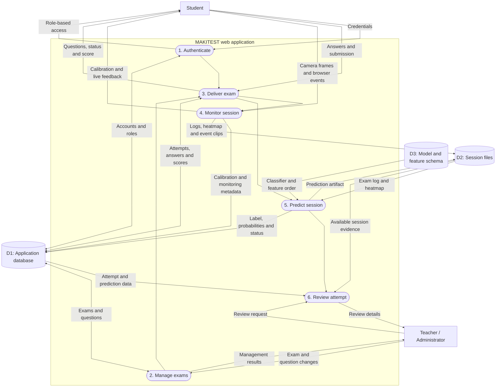
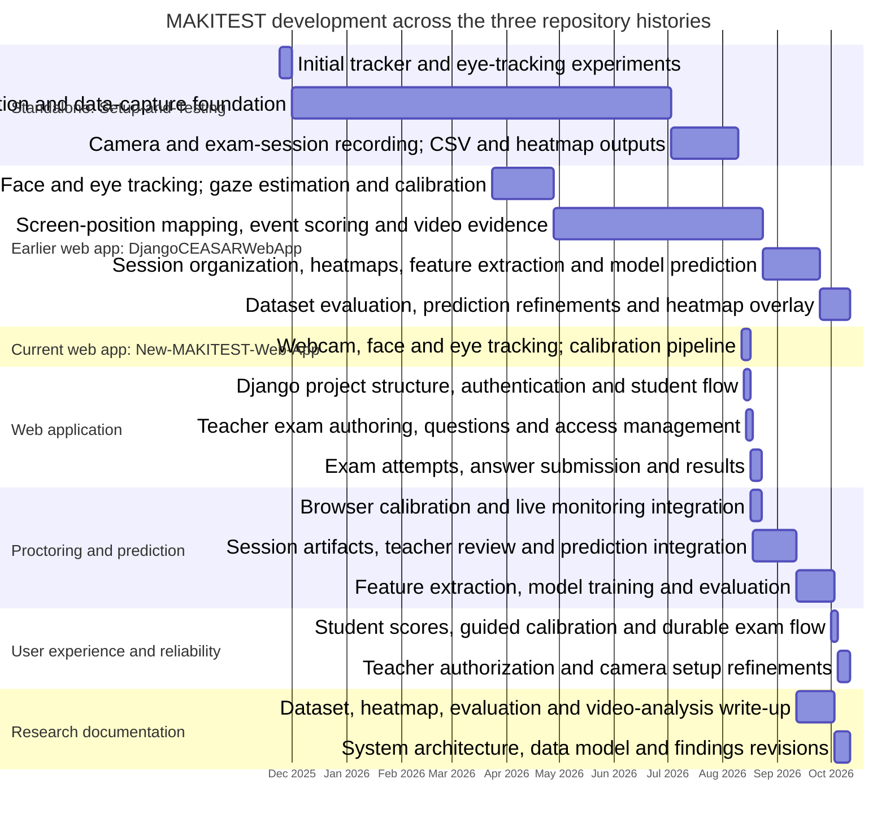

# Appendix A
## High-Level Data Flow Diagram of the MAKITEST System

### A.1 Purpose and scope

This appendix presents the high-level data flow of the MAKITEST Suspicious Exam Behavior Detection System (SEBDS). It describes how information moves among students, teachers and administrators, the browser-based application, its database, session-artifact storage, and the machine-learning prediction component.

The diagram represents the integrated Django web application. In this workflow, the student uses a standard web browser to access exams and, when monitoring is active, to provide camera frames and browser-reported events. The application processes those inputs to produce session artifacts and a classifier result for review. The separate desktop tracker and offline dataset-training workflow are not part of the web-session flow shown here.

The DFD is an implementation-level overview rather than a deployment topology. It shows logical processes and stores, not individual Django views, model fields, network infrastructure, or every validation rule.

### A.2 High-level DFD

### A.3 Description of entities, processes, and stores

#### External entities

**Student.** The student authenticates through the web application, views eligible exams, completes and submits answers, and participates in the browser-based calibration and monitoring flow. Subject to browser permission and the active session, the client sends camera frames and browser-reported monitoring events to the application. The browser is the source of those inputs; the diagram does not imply that the system captures operating-system-wide activity.

**Teacher or administrator.** Teaching staff create and manage exams and questions, configure exam access, and review submitted attempts. Review information can include scores, prediction status, and available monitoring artifacts. Administrative operations are grouped with teacher-facing management in this high-level view.

#### Application processes

**1. Authenticate and route users.** The application verifies account credentials and uses account roles to direct users to the relevant student, teacher, or administrative pages. Account records and web-session state are maintained through the application database and Django session facilities.

**2. Prepare and manage exams.** Teachers create or update exams and their questions, including access and class-related settings. The process stores exam content in the database and makes eligible exam information available to students.

**3. Deliver exam and record answers.** The application presents exam questions, tracks an attempt, accepts saved answers, and finalizes the attempt when submitted or otherwise completed. It calculates the score from the recorded answers and exam key. Attempt and answer records, along with prediction fields, are stored in the database.

**4. Calibrate and monitor session.** Before monitored exam activity, the browser guides the student through calibration. During the exam, browser-captured camera frames are sent to the monitoring service over a WebSocket connection. The server-side gaze pipeline processes frames for face and eye landmarks, gaze position or direction, head pose, heatmap accumulation, and rule-based event scoring. Browser-reported events, such as selected key combinations or loss of page focus, may also be received. Calibration thresholds and monitoring status are associated with the student or attempt; generated logs and other session evidence are written to session storage.

**5. Register artifacts and predict.** At the end of a monitored attempt, the application registers the session’s files and uses the final exam-session CSV and heatmap as prediction inputs. The prediction component combines extracted session features with the configured feature order and trained classifier. It records prediction status and result fields against the attempt and writes a prediction JSON artifact when produced. If required inputs or inference are unavailable, the attempt can retain an unavailable or failed prediction status rather than treating the absence of a result as a positive prediction.

**6. Review attempts and evidence.** Teachers request a student-attempt review. The application retrieves attempt, score, and prediction information from the database and obtains the registered session artifacts from file storage when available. It presents these materials as review information to support staff judgment; a classifier result is not, by itself, a determination of misconduct.

#### Data stores

**D1: Application database.** In the current project configuration, Django uses SQLite. The database contains user and role data, exam and question records, student answers, attempt and score information, calibration-related records, and registered artifact paths and prediction fields. The diagram groups these logical records into one store for readability.

**D2: Session and media files.** The application writes uploaded or generated media under its media directory. A proctoring session may contain calibration data, timestamped CSV logs, a heatmap image, violation video clips, and a prediction JSON artifact. The database keeps references to registered files; the files themselves are not represented as database rows containing their full contents.

**D3: Classifier and feature schema.** The prediction process reads the trained model (`suspicion_model.joblib`) and the expected input-column order (`feature_columns.json`) from application files. These are inputs to inference, not per-student session records.

### A.4 Principal data-flow sequence

The flow begins when a student authenticates and requests an exam. The application checks the relevant account, role, and exam information, then returns exam content for an eligible attempt. As the student answers questions, answer and attempt state is persisted. On submission, the application grades the stored answers and finalizes the attempt.

For monitored activity, the application establishes a session identifier and uses it to associate the calibration and exam-monitoring phases with the same session directory. The browser sends camera frames and supported browser events to the monitoring process. Calibration data and exam monitoring outputs are written as session files; attempt and calibration metadata are stored in the database. At finalization, the application registers available artifacts and requests session prediction using the exam log and heatmap—not the calibration log—as session evidence. The resulting status and prediction values are associated with the attempt, after which a teacher can review the attempt and its available evidence.

### A.5 Interpretation and system boundary

The diagram distinguishes **observations**, **derived artifacts**, and **application records**. Camera frames and browser events are inputs; gaze estimates, rule-triggered events, heatmaps, and session logs are derived outputs; answers, scores, attempt state, and prediction fields are persisted application records. This separation is important because an observed gaze direction or a model-generated label is an indicator for review, not proof that a student engaged in misconduct.

The implemented monitoring path is browser-based and focuses on face and eye landmark tracking, gaze estimation, head-pose analysis, heatmaps, rule-based event scoring, and browser-reported events. It does not represent facial recognition, liveness detection, object or hand detection, audio analysis, or a global keyboard hook as implemented components. Data retention, production hosting, and multi-worker deployment are outside the scope of this logical DFD.

# Appendix B
## Development Timeline of the MAKITEST System

### B.1 Basis of the timeline

This timeline synthesizes the dated Git commit histories of the current repository and the two related repositories, [Setup-and-Testing](https://github.com/pfftbuh/Setup-and-Testing) and [DjangoCEASARWebApp](https://github.com/pfftbuh/DjangoCEASARWebApp), together with the current project structure. It groups related commits into system-development workstreams rather than listing every commit individually. The dates indicate when a notable implementation or documentation change is recorded in a repository; they should not be interpreted as the exact start and finish dates of all work.

Across the three histories, the chart covers November 24, 2025, through October 12, 2026. To avoid displaying empty intervals, a workstream with no subsequent notable update is extended to the next relevant milestone or the end of its observed history. These extensions are a presentation convention and do not imply continuous development on every intervening day. Parallel workstreams may overlap.

### B.2 Gantt chart

### B.3 Interpretation of development phases

**Standalone prototype — [Setup-and-Testing](https://github.com/pfftbuh/Setup-and-Testing) (November 24, 2025–August 10, 2026).** The earliest recorded work covers the first tracker and iris-tracking experiments, followed by calibration, gaze tracking, and data-capture changes. Later commits record camera and exam-session handling and the addition of CSV and heatmap outputs. The December-to-July bar carries the earlier tracking and data-capture work forward to the next notable recorded update, as requested; it does not claim that development occurred continuously during that interval.

**Earlier web-app lineage — [DjangoCEASARWebApp](https://github.com/pfftbuh/DjangoCEASARWebApp) (March 24–October 12, 2026).** The available commit history records face and eye tracking, gaze estimation, calibration, and data collection from March onward. Subsequent milestones add screen-position mapping, event-based suspicion scoring, and video evidence. August commits organize session output and introduce heatmap feature extraction, model training, and prediction; later commits revise dataset observations and prediction outputs and add heatmap-overlay work.

**Current web application — [New-MAKITEST-Web-App](https://github.com/pfftbuh/New-MAKITEST-Web-App) (August 12–October 12, 2026).** The repository history records the Django web application foundation, user authentication, student and teacher workflows, exam authoring, attempts, answers, grading, and results. Monitoring is integrated with calibration and browser-based exam sessions; the application subsequently registers session artifacts, supports teacher evidence review, and connects session data to prediction.

**Feature engineering and model evaluation (August 27–October 3, 2026).** Commits across the earlier web-app and current project histories record heatmap-derived features, Random Forest training and evaluation, prediction output, configurable evaluation procedures, and dataset documentation. These changes connect session-level evidence to structured features and classifier output.

**User experience, authorization, and reliability (October 1–12, 2026).** Work recorded in the current web-app history includes a student scores page, faster camera capture settings, guided calibration and exam-flow improvements, consistent interface labels, teacher authorization checks, and clearer camera setup instructions.

**Research documentation (September 12–October 12, 2026).** Manuscript updates document video evidence, gaze and heatmap analysis, model evaluation, dataset fields, system architecture, data modeling, and later interpretation of results. This is shown separately from software implementation because manuscript changes form a parallel research-documentation stream.

### B.4 Reading the chart

The chart is a high-level reconstruction from the three linked Git histories and the current project structure, not a project-management schedule. Related workstreams overlap because the repositories represent the standalone prototype, an earlier web-app lineage, and the current integrated web application. Some histories also contain merges or mirrored development; overlapping bars therefore indicate related recorded milestones, not necessarily independent work. Where a bar bridges a period without a notable commit, the extension follows the convention stated in B.1 and should not be read as evidence of continuous work, exact feature-completion dates, effort, or deployment readiness.
